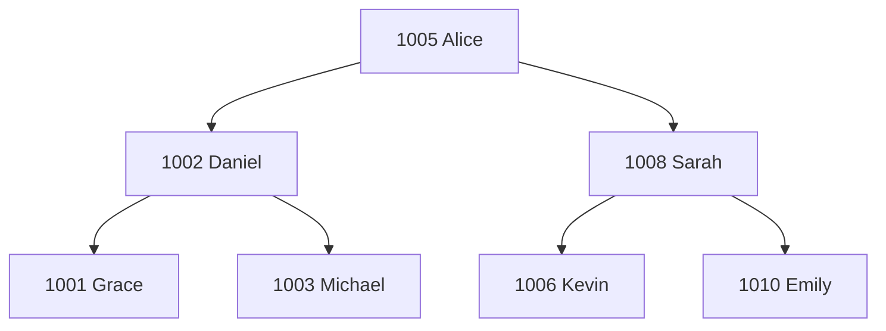
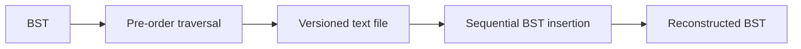

# BST Record Management System — Modern C++

[](#)
[](#)
[](LICENSE)


**English** · [中文](README.zh-CN.md)

A command-line teacher record manager backed by a **Binary Search Tree (BST)**, written in modern C++17.

This project began as a Data Structures coursework project by **Shuoxun Wen (温硕勋)** during my earlier undergraduate studies. I revisited and modernised it in 2026 to improve correctness, memory safety, modularity, persistence, testing, and overall software-engineering quality.

> The original coursework source is preserved in [`legacy/`](legacy/). The main codebase is a modern reimplementation rather than a cosmetic rewrite of the old file.

## Highlights

- Binary Search Tree implemented from first principles
- Insert, search, update, and delete teacher records
- Correct handling of all BST deletion cases
  - leaf node
  - one child
  - two children via the in-order successor
- Sorted display using in-order traversal
- Shape-preserving persistence using pre-order traversal
- `std::unique_ptr` ownership and RAII — no manual `malloc/free`
- Safe string and numeric input handling
- Versioned, human-readable persistence format
- Automated tests with CTest
- No third-party runtime dependencies

## Why revisit an old coursework project?

The original program already demonstrated the core data-structures concepts, but it also reflected the style and constraints of an early programming course: a single large source file, C-style strings, raw allocation, unsafe input APIs, and limited automated testing.

Rebuilding it is a useful exercise in **legacy-code modernisation**: keeping the original algorithmic intent while applying stronger software-engineering practices.

A notable correctness issue in the coursework version was the deletion dispatcher. Its "one child" condition used logical OR, which also matched nodes with two children, making the dedicated two-child branch unreachable. The modern implementation separates all three cases correctly and tests them independently. See [`docs/MODERNISATION.md`](docs/MODERNISATION.md).

## Data model

Each node stores a teacher record:

```cpp
struct Teacher {
    int id;
    std::string name;
    std::string gender;
    int age;
    std::string title;
};
```

`id` is the BST key. Duplicate IDs are rejected.

## How the BST works



For each node:

```text
left subtree IDs < node ID < right subtree IDs
```

An in-order traversal therefore produces teacher records sorted by ID.

## Persistence strategy

The project preserves one of the more interesting ideas from the original coursework:
**save records in pre-order traversal, then reinsert them in the same order when loading**.



For unique keys, this reconstructs the same BST shape.

Unlike the coursework version, the modern project does not dump compiler-dependent raw struct bytes. Its text format is portable and inspectable:

```text
BST_TEACHERS_V1
1005 "Alice Tan" "Female" 46 "Associate Professor"
1002 "Daniel Lim" "Male" 38 "Senior Lecturer"
```

## Project structure

```text
.
├── CMakeLists.txt
├── include/
│   ├── BinarySearchTree.hpp
│   ├── Storage.hpp
│   └── Teacher.hpp
├── src/
│   ├── BinarySearchTree.cpp
│   ├── Storage.cpp
│   └── main.cpp
├── tests/
│   └── bst_tests.cpp
├── data/
│   └── sample_teachers.db
├── docs/
│   ├── DESIGN.md
│   └── MODERNISATION.md
└── legacy/
    ├── README.md
    └── original_coursework.cpp
```

## Build

Requirements:

- CMake 3.16+
- a C++17 compiler (GCC, Clang, or MSVC)

### macOS / Linux

```bash
cmake -S . -B build
cmake --build build
```

### Windows (Visual Studio generator)

```powershell
cmake -S . -B build
cmake --build build --config Release
```

## Run

Start with an empty tree:

```bash
./build/bst_record_manager
```

Or load the included sample data immediately:

```bash
./build/bst_record_manager data/sample_teachers.db
```

On Windows with a multi-config generator, the executable is usually under `build/Release/`.

## CLI

```text
=== BST Teacher Record Manager ===
1. List teachers (sorted by ID)
2. Find teacher
3. Add teacher
4. Update teacher
5. Delete teacher
6. Save
7. Load
0. Exit
```

## Tests

Build and run the automated tests:

```bash
cmake -S . -B build
cmake --build build
ctest --test-dir build --output-on-failure
```

The tests cover insertion, duplicate rejection, lookup, traversal, updates, each structural deletion case, root deletion, persistence round-trips, and malformed input files.

## Complexity

For a BST of height `h`:

| Operation | Average* | Worst case |
| --- | ---: | ---: |
| Search | `O(log n)` | `O(n)` |
| Insert | `O(log n)` | `O(n)` |
| Delete | `O(log n)` | `O(n)` |
| Traversal | `O(n)` | `O(n)` |

\*When the tree is reasonably balanced. This is intentionally a plain BST rather than an AVL or Red-Black Tree, so sorted input can produce a skewed tree.

## Modernisation summary

| Coursework implementation | Modern version |
| --- | --- |
| C-style fixed-size character arrays | `std::string` |
| `gets()` input | validated `std::getline()` / stream input |
| `malloc()` / `free()` | `std::unique_ptr` + RAII |
| monolithic source file | model / BST / storage / CLI separation |
| raw binary struct persistence | versioned portable text format |
| two-child deletion dispatch bug | mutually exclusive, tested deletion cases |
| manual verification | automated CTest suite |

For the detailed engineering notes, see [`docs/MODERNISATION.md`](docs/MODERNISATION.md) and [`docs/DESIGN.md`](docs/DESIGN.md).

## Related Coursework

For additional implementations from the same Data Structures course, including stacks, queues, trees, Huffman coding, graph traversal, and sorting algorithms, see:

**[Data Structures Labs in C++](https://github.com/Waldo0926/data-structures-labs-cpp)**

## License

MIT License. See [`LICENSE`](LICENSE).
