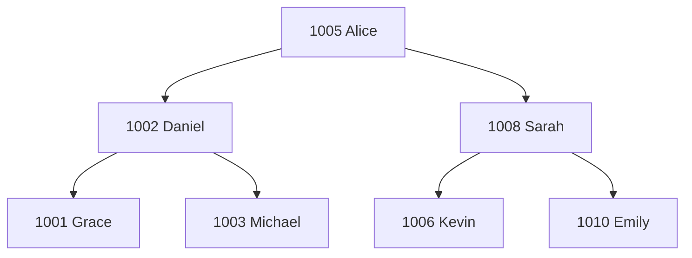
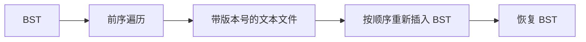

# BST 教师信息管理系统（现代 C++）

[](#)
[](#)
[](LICENSE)


[English](README.md) · **中文**

这是一个基于 **二叉搜索树（Binary Search Tree, BST）** 的命令行教师信息管理系统，使用现代 C++17 编写。

该项目最初来自我本科早期阶段完成的数据结构课程设计，作者为 **Shuoxun Wen（温硕勋）**。我在 2026 年重新检查并现代化重构了这个项目，以提升其正确性、内存安全性、模块化程度、持久化设计、测试能力和整体软件工程质量。

> 原始课程设计源码保留在 [`legacy/`](legacy/) 中。当前主代码并不是对旧文件进行简单美化，而是基于原有数据结构思想进行的现代化重新实现。

## 项目亮点

- 从基础实现 Binary Search Tree
- 支持教师记录的新增、查询、修改和删除
- 正确处理 BST 删除操作的所有结构情况
  - 叶子节点
  - 单子节点
  - 通过中序后继处理双子节点
- 使用中序遍历按教师编号排序显示
- 使用前序遍历实现保持树形结构的持久化
- 使用 `std::unique_ptr` 和 RAII 管理所有权，不再手动 `malloc/free`
- 更安全的字符串与数字输入处理
- 带版本标识、可人工阅读的持久化文件格式
- 使用 CTest 进行自动化测试
- 无第三方运行时依赖

## 为什么重新整理一个旧课程设计？

原始程序已经体现了二叉搜索树等核心数据结构概念，但同时也明显保留了早期编程课程的实现风格和限制，例如：单个大型源文件、C 风格字符串、手动内存分配、不安全的输入 API，以及缺乏自动化测试。

重新实现这个项目的价值在于进行一次 **legacy code modernisation（旧代码现代化）**：保留原有算法设计意图，同时应用更规范的软件工程实践。

原课程设计中有一个比较典型的正确性问题：删除节点时，用于判断“单子节点”的条件使用了逻辑 OR，这会同时匹配具有两个子节点的节点，从而使专门处理“双子节点”的分支无法执行。现代版本将三种删除情况严格区分，并分别编写测试进行验证。详见 [`docs/MODERNISATION.md`](docs/MODERNISATION.md)。

## 数据模型

每个 BST 节点保存一条教师记录：

```cpp
struct Teacher {
    int id;
    std::string name;
    std::string gender;
    int age;
    std::string title;
};
```

其中 `id` 作为 BST 的键值。重复教师编号会被拒绝。

## BST 如何工作



对于任意节点：

```text
左子树 ID < 当前节点 ID < 右子树 ID
```

因此，中序遍历可以按教师编号从小到大输出所有记录。

## 持久化策略

项目保留了原课程设计中一个较有意思的思路：

**使用前序遍历保存记录，然后在加载时按照相同顺序依次重新插入 BST。**



在键值唯一的情况下，这种方式可以恢复相同的 BST 结构。

与原课程设计不同，现代版本不会直接将与编译器相关的原始结构体二进制内容写入文件，而是采用可移植、可人工检查的文本格式：

```text
BST_TEACHERS_V1
1005 "Alice Tan" "Female" 46 "Associate Professor"
1002 "Daniel Lim" "Male" 38 "Senior Lecturer"
```

## 项目结构

```text
.
├── CMakeLists.txt
├── include/
│   ├── BinarySearchTree.hpp
│   ├── Storage.hpp
│   └── Teacher.hpp
├── src/
│   ├── BinarySearchTree.cpp
│   ├── Storage.cpp
│   └── main.cpp
├── tests/
│   └── bst_tests.cpp
├── data/
│   └── sample_teachers.db
├── docs/
│   ├── DESIGN.md
│   └── MODERNISATION.md
└── legacy/
    ├── README.md
    └── original_coursework.cpp
```

## 构建

环境要求：

- CMake 3.16+
- 支持 C++17 的编译器（GCC、Clang 或 MSVC）

### macOS / Linux

```bash
cmake -S . -B build
cmake --build build
```

### Windows（Visual Studio generator）

```powershell
cmake -S . -B build
cmake --build build --config Release
```

## 运行

以空 BST 启动：

```bash
./build/bst_record_manager
```

或者启动时直接加载项目提供的示例数据：

```bash
./build/bst_record_manager data/sample_teachers.db
```

在 Windows 的多配置生成器下，可执行文件通常位于 `build/Release/`。

## 命令行界面

```text
=== BST Teacher Record Manager ===
1. List teachers (sorted by ID)
2. Find teacher
3. Add teacher
4. Update teacher
5. Delete teacher
6. Save
7. Load
0. Exit
```

## 测试

构建并运行自动化测试：

```bash
cmake -S . -B build
cmake --build build
ctest --test-dir build --output-on-failure
```

测试覆盖插入、重复 ID 拒绝、查询、遍历、修改、各种结构下的删除操作、根节点删除、持久化往返测试，以及格式错误的输入文件。

## 时间复杂度

对于高度为 `h` 的 BST：

| 操作 | 平均情况* | 最坏情况 |
| --- | ---: | ---: |
| 查询 | `O(log n)` | `O(n)` |
| 插入 | `O(log n)` | `O(n)` |
| 删除 | `O(log n)` | `O(n)` |
| 遍历 | `O(n)` | `O(n)` |

\*前提是树大致保持平衡。本项目有意实现普通 BST，而不是 AVL Tree 或 Red-Black Tree，因此按顺序插入的数据可能形成退化树。

## 现代化重构总结

| 原课程设计实现 | 现代版本 |
| --- | --- |
| C 风格固定长度字符数组 | `std::string` |
| `gets()` 输入 | 经过校验的 `std::getline()` / stream input |
| `malloc()` / `free()` | `std::unique_ptr` + RAII |
| 单体大型源文件 | model / BST / storage / CLI 分离 |
| 原始结构体二进制持久化 | 带版本号的可移植文本格式 |
| 双子节点删除分发逻辑错误 | 互斥且经过测试的删除分支 |
| 手工验证 | 自动化 CTest 测试 |

详细的工程设计与现代化说明见 [`docs/MODERNISATION.md`](docs/MODERNISATION.md) 和 [`docs/DESIGN.md`](docs/DESIGN.md)。

## 相关课程项目

同一门数据结构课程中的其他实验，包括栈、队列、树、哈夫曼编码、图遍历与排序算法，已整理到：

**[Data Structures Labs in C++](https://github.com/Waldo0926/data-structures-labs-cpp)**

## License

MIT License，详见 [`LICENSE`](LICENSE)。
